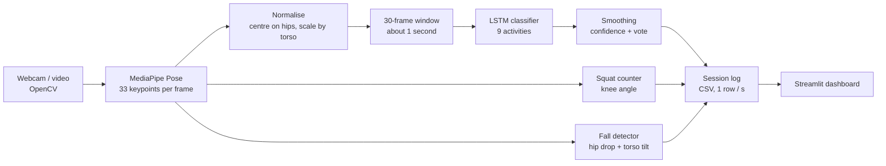
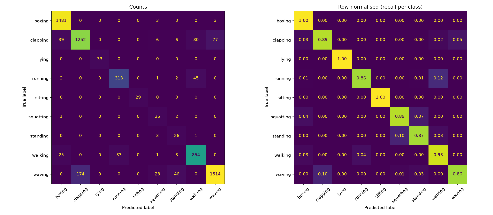

# ActiSense – Human Activity Recognition and Analysis

ActiSense recognises human activities in real time from an ordinary webcam and turns them into a session
report: time per activity, activity transitions, exercise repetitions and fall alerts. It runs on a CPU-only
laptop and uses only open-source software.

| Result | Value |
|---|---|
| Activity accuracy on **people never seen in training** (9 activities, 6,053 test windows) | **91.3%** |
| Macro-F1 (fair score for unbalanced classes) | **0.842** |
| Fall detection on UR Fall (30 falls, 40 daily-living clips) | **80% sensitivity, 100% specificity** |

## How it works



1. **Perception** – MediaPipe Pose turns every frame into 33 body keypoints. Each skeleton is centred on the
   mid-hip and scaled by torso length, so position and distance from the camera do not matter.
2. **Recognition** – 30 consecutive skeletons (about 1 second) go through a 2-layer LSTM. Predictions under
   60% confidence are ignored and a majority vote over the last 8 removes flicker.
3. **Analysis** – a knee-angle state machine counts squats, a rule detects falls (fast hip drop + torso
   tilting towards horizontal), everything is logged once per second and shown in a dashboard.

Only skeleton numbers are stored, never video.

## Activities

| From the KTH dataset | From own webcam recordings |
|---|---|
| walking, running, boxing, waving, clapping | sitting, standing, squatting, lying |

## Results

Three model versions were trained and compared (ablation study). Test set = the 9 people of the official KTH
test split plus 20% of the own recordings; the best epoch is chosen on a separate validation set.

| Test measure | v1 strong class weights | v2 soft weights | **v3 + no visibility + augmentation** |
|---|---|---|---|
| Accuracy | 0.907 | 0.909 | **0.913** |
| Balanced accuracy | **0.941** | 0.904 | 0.922 |
| Macro-F1 | 0.823 | 0.803 | **0.842** |

v1 and v2 showed a *camera shortcut*: all webcam activities came from one sharp camera while KTH videos are
small and blurry, so the model partly learned which camera a clip came from. Dropping MediaPipe's visibility
scores and adding skeleton augmentation (rotation ±20°, scaling, noise) in v3 removed most of those errors.



Remaining confusions are look-alike pairs: waving ↔ clapping and running ↔ walking.

**Fall detector** (12 threshold settings tested on UR Fall, full table in `fall_eval.csv`):

| Hip drop | Tilt | Falls caught | False alarms | Sensitivity | Specificity |
|---|---|---|---|---|---|
| 0.10 | 45° | 26 / 30 | 7 / 40 | 0.867 | 0.825 |
| **0.15** | **45°** | **24 / 30** | **0 / 40** | **0.800** | **1.000** |
| 0.20 | 60° | 16 / 30 | 0 / 40 | 0.533 | 1.000 |

The thresholds were selected and scored on the same 70 clips, so this is the best operating point on UR Fall,
not a held-out estimate.

## Project structure

| File | Purpose |
|---|---|
| `common.py` | Shared code: pose features, normalisation, LSTM model, fall rule |
| `download_datasets.py` | Downloads and unpacks KTH and UR Fall |
| `extract_dataset.py` | Turns labelled videos / frame folders into 30-frame pose windows (resumable) |
| `collect_data.py` | Records labelled pose windows from the webcam |
| `train.py` | Trains and evaluates the LSTM; writes `results_<tag>.txt`, `confusion_matrix_<tag>.png`, model |
| `evaluate_falls.py` | Measures the fall detector on UR Fall for several thresholds |
| `run_app.py` | Live recognition, squat counter, fall alert, CSV session log |
| `dashboard.py` | Streamlit dashboard for a recorded session |
| `uci_har_baseline.py` | Optional smartphone-sensor baseline on the UCI HAR dataset |
| `GUIDE.md` | Detailed step-by-step procedure with troubleshooting |

## Setup

Requires Python **3.10, 3.11 or 3.12** (MediaPipe 0.10.14 has no Python 3.13 build) and a webcam.

```powershell
git clone https://github.com/SHARMI-P/actisense.git
cd actisense
python -m venv venv
.\venv\Scripts\Activate.ps1          # Linux/macOS: source venv/bin/activate
pip install -r requirements.txt
```

## Usage

```powershell
# 1. Data (datasets are not included in this repository, see below)
python download_datasets.py
python extract_dataset.py --root videos --map handwaving=waving,handclapping=clapping --skip jogging
python collect_data.py --action sitting --sequences 150     # repeat for standing, squatting, lying

# 2. Train the final model (KTH official test people held out)
python train.py --test-pattern "person(02|03|05|06|07|08|09|10|22)_" --features xyz --augment --tag v3
Copy-Item har_model_v3.pt har_model.pt

# 3. Evaluate the fall detector
python evaluate_falls.py --root urfall

# 4. Run live, then analyse the session
python run_app.py            # press q to quit
streamlit run dashboard.py
```

## Datasets

The datasets are **not redistributed** here; `download_datasets.py` fetches them from their official pages.
Both are for non-commercial research use and must be cited.

- **KTH Actions** – C. Schuldt, I. Laptev, B. Caputo, "Recognizing human actions: a local SVM approach",
  ICPR 2004. https://www.csc.kth.se/cvap/actions/
- **UR Fall Detection** – B. Kwolek, M. Kępski, "Human fall detection on embedded platform using depth maps and
  wireless accelerometer", Computer Methods and Programs in Biomedicine 117(3), 489–501, 2014.
  https://fenix.ur.edu.pl/~mkepski/ds/uf.html (CC BY-NC-SA 4.0)

## Limitations and future work

- Webcam activities come from one person and one room; more people are needed for a person-independent score.
- One person is tracked at a time; the fall detector is rule-based and misses slow falls.
- Planned novelty: **open-set and few-shot recognition** – answer "unknown" for unseen activities and learn a
  new activity from about five examples using embedding prototypes.

## Built with

[MediaPipe](https://github.com/google-ai-edge/mediapipe) · [PyTorch](https://pytorch.org) ·
[OpenCV](https://opencv.org) · [scikit-learn](https://scikit-learn.org) · [Streamlit](https://streamlit.io)
