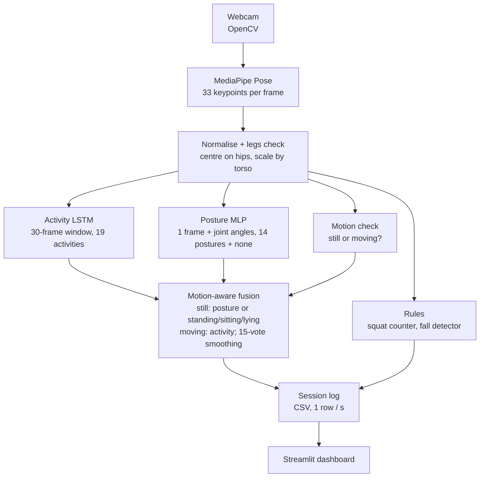
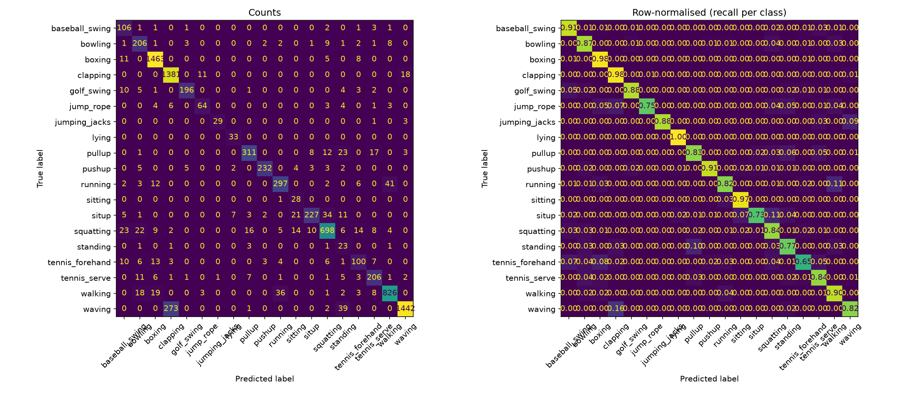
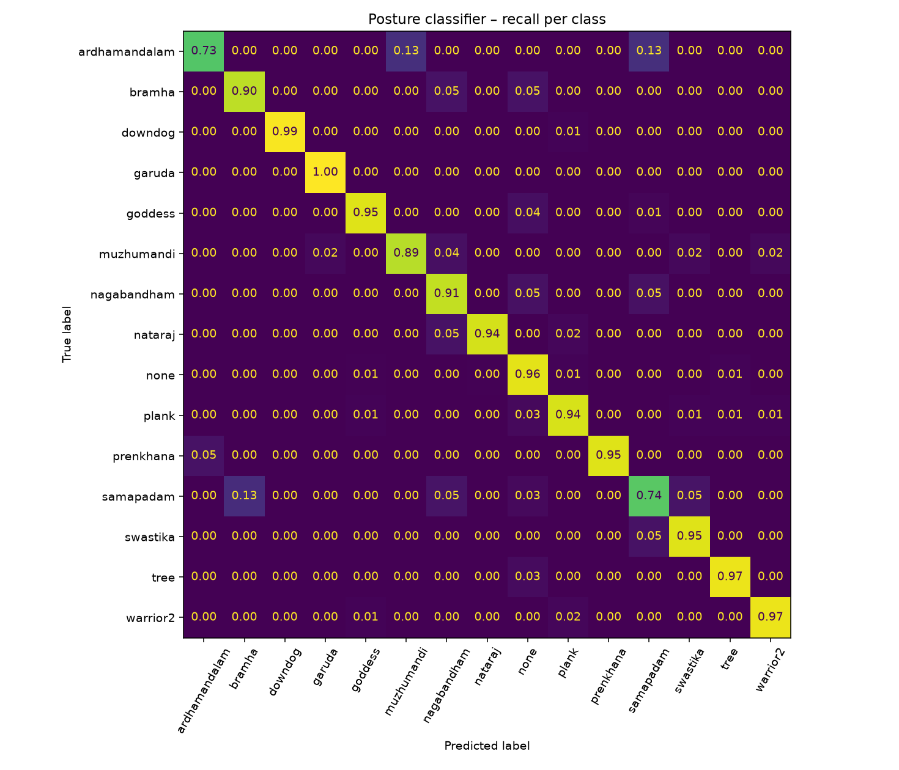

# ActiSense – Human Activity Recognition and Analysis

ActiSense recognises human **activities** (everyday movements, exercises and sports) and held **postures**
(Bharatanatyam and yoga) in real time from an ordinary webcam, and turns a session into a report: time per
activity and posture, activity transitions, exercise repetitions and fall alerts. It runs on a CPU-only laptop,
uses only open-source software and public datasets, and does its heavy training on free Kaggle notebooks.

*Mini Project II – Indian Institute of Information Technology Dharwad. P. Sharmi (23BCS090), guide: Dr. Sunil C K.*

| Result (test data never seen in training) | Value |
|---|---|
| **Activity model v4** – 19 activities, 8,890 test windows | **88.5% accuracy**, macro-F1 0.813 |
| **Posture model** – 9 Bharatanatyam + 5 yoga postures + "none", 2,442 test samples | **95.2% accuracy**, macro-F1 0.891 |
| &nbsp;&nbsp;yoga, on the dataset's official test images (465) | 96.3% |
| &nbsp;&nbsp;Bharatanatyam, random 20% hold-out (283) – optimistic, see Limitations | 89.0% |
| **Fall detector** on UR Fall (30 falls, 40 daily-living clips) | **80% sensitivity, 100% specificity** |

## What it recognises

| Group | Classes | Source |
|---|---|---|
| Daily activities | walking, running, boxing, waving, clapping | KTH Actions |
| Daily activities | sitting, standing, squatting, lying | own webcam recordings |
| Exercises | jumping jacks, push-up, sit-up, pull-up, jump rope, squat (merged into squatting) | Penn Action |
| Sports | tennis serve, tennis forehand, golf swing, baseball swing, bowling | Penn Action |
| Bharatanatyam postures | Ardhamandalam, Bramha, Garuda, Muzhumandi, Nagabandham, Nataraj, Prenkhana, Samapadam, Swastika | Bharatnatyam Dance Poses (Kaggle) |
| Yoga poses | downward dog, goddess, plank, tree, warrior II | Yoga Poses Dataset (Kaggle) |

## How it works



1. **Perception** – MediaPipe Pose turns every frame into 33 body keypoints. Each skeleton is centred on the
   mid-hip and scaled by torso length, so position and distance from the camera do not matter. A legs check tests
   whether knees and ankles are inside the frame.
2. **Recognition** – two trained models read the same skeleton:
   - an **LSTM** (2 layers, 128 units) on 30 consecutive frames (about 1 s) for *activities*;
   - a small **MLP** on a single frame (99 coordinates + 8 joint angles) for *held postures*, with a `none`
     class so it can say "not a posture".
3. **Fusion** – the amount of movement over the last 15 frames decides which answer is shown. While still, a
   confident held posture is shown ("Pose: Prenkhana"), otherwise only standing, sitting or lying; while moving,
   the activity label. A label changes only when it wins a majority of the last 15 predictions.
4. **Analysis** – a knee-angle state machine counts squats, a rule detects falls (fast hip drop + torso tilting
   towards horizontal), everything is logged once per second and shown in a dashboard.

Only skeleton numbers are stored, never video.

## Results

### Activity model: four versions (ablation study)

Test set = KTH official test people (2, 3, 5–10, 22) + Penn Action official test videos + 20% of own recordings.
The best epoch is chosen on a separate validation set; windows from one video never cross the split.

| Test measure | v1 strong weights | v2 soft weights | v3 + no visibility + augmentation | **v4 + sports/exercises** |
|---|---|---|---|---|
| Activities | 9 | 9 | 9 | **19** |
| Test windows | 6,053 | 6,053 | 6,053 | **8,890** |
| Accuracy | 0.907 | 0.909 | 0.913 | **0.885** |
| Balanced accuracy | 0.941 | 0.904 | 0.922 | **0.859** |
| Macro-F1 | 0.823 | 0.803 | 0.842 | **0.813** |

v1 and v2 showed a *camera shortcut*: all webcam activities came from one sharp camera while KTH videos are small
and blurry, so the model partly learned which camera a clip came from. Dropping MediaPipe's visibility scores and
adding skeleton augmentation (rotation ±20°, scaling, noise) in v3 removed most of those errors; v4 keeps them.



Main v4 confusions: waving → clapping (15.5% of waving), running ↔ walking, sit-up → squatting (10.9%), and the
sports swings among each other. Standing (precision 0.19) and sitting (0.42) are found when they happen
(recall 0.77, 0.97) but are also predicted for pauses in other activities.

### Posture model



Best postures: downward dog (F1 0.98), Prenkhana (0.97), warrior II (0.96), Garuda (0.94). Weakest: Samapadam
(0.77, confused with Bramha) and Bramha (0.80). Most errors are activity frames read as a pose (e.g. a push-up
frame as plank); the live motion check removes most of these because postures are shown only while still.

### Fall detector

12 threshold settings tested on UR Fall (full table in `fall_eval.csv`):

| Hip drop | Tilt | Falls caught | False alarms | Sensitivity | Specificity |
|---|---|---|---|---|---|
| 0.10 | 45° | 26 / 30 | 7 / 40 | 0.867 | 0.825 |
| **0.15** | **45°** | **24 / 30** | **0 / 40** | **0.800** | **1.000** |
| 0.20 | 60° | 16 / 30 | 0 / 40 | 0.533 | 1.000 |

The thresholds were selected and scored on the same 70 clips, so this is the best operating point on UR Fall,
not a held-out estimate.

## Project structure

| File | Purpose |
|---|---|
| `common.py` | Shared code: pose features, normalisation, joint angles, motion energy, LSTM and MLP models, fall rule |
| `download_datasets.py` | Downloads and unpacks KTH and UR Fall |
| `extract_dataset.py` | Labelled videos / frame folders → 30-frame pose windows (resumable) |
| `extract_penn.py` | Penn Action sports/exercise videos → pose windows, official train/test split kept (parallel, resumable) |
| `extract_images.py` | Folders of posture images (yoga, Bharatanatyam) → skeleton features (`.npz`) |
| `collect_data.py` | Records labelled pose windows from the webcam |
| `train.py` | Trains and evaluates the activity LSTM; writes `results_<tag>.txt`, `confusion_matrix_<tag>.png`, model |
| `train_pose.py` | Trains the posture MLP with a `none` class; writes `pose_model.pt`, `results_pose.txt`, confusion matrix |
| `evaluate_falls.py` | Measures the fall detector on UR Fall for several thresholds |
| `run_app.py` | Live recognition: activities, postures, squat counter, fall alert, step-back warning, CSV log |
| `dashboard.py` | Streamlit dashboard for a recorded session (activities and postures) |
| `actisense_kaggle.ipynb` | Kaggle notebook: extraction and training of both models |
| `uci_har_baseline.py` | Optional smartphone-sensor baseline on the UCI HAR dataset |
| `GUIDE.md` | Detailed step-by-step procedure with troubleshooting |

## Setup (laptop)

Requires Python **3.10, 3.11 or 3.12** (MediaPipe 0.10.14 has no Python 3.13 build) and a webcam.

```powershell
git clone https://github.com/SHARMI-P/actisense.git
cd actisense
python -m venv venv
.\venv\Scripts\Activate.ps1          # Linux/macOS: source venv/bin/activate
pip install -r requirements.txt
```

## Workflow: heavy work on Kaggle, live use on the laptop

### 1. Train on Kaggle

1. Upload your own `data/` windows (from `collect_data.py`) as a **private** Kaggle dataset, e.g. `actisense-data`.
   Zip it with Python, not Windows' zip tool (Kaggle rejects backslash paths):
   `python -c "import shutil; shutil.make_archive('actisense-data', 'zip', 'data')"`
2. Create a Kaggle notebook from `actisense_kaggle.ipynb`. Settings: **Internet on, Accelerator None**.
   Add inputs: `actisense-data`, `kaushalbora18/penn-action-dataset`, `niharika41298/yoga-poses-dataset`,
   `pranavmanoj/bharatnatyam-dance-poses`.
3. Run the cells in order. The notebook clones this repository, builds a Python 3.11 environment with `uv`
   (Kaggle's default Python 3.13 cannot install MediaPipe 0.10.14), extracts Penn Action and the posture images
   on 4 CPU cores, and trains both models. The main commands it runs:

```bash
python extract_penn.py --root "$PENN" --out data_penn --workers 4
python extract_images.py --root "$YOGA/TRAIN" --split train --source yoga --out poses_yoga_train.npz
python extract_images.py --root "$YOGA/TEST"  --split test  --source yoga --out poses_yoga_test.npz
python extract_images.py --root "$BHARAT" --strip " Augmented" --source bharatanatyam --out poses_bharat.npz
python train.py --data "$ACTI" data_penn --test-pattern "person(02|03|05|06|07|08|09|10|22)_|pennTest_" \
                --features xyz --augment --tag v4
python train_pose.py --poses poses_yoga_train.npz poses_yoga_test.npz poses_bharat.npz \
                     --negatives "$ACTI" data_penn --test-pattern "person(02|03|05|06|07|08|09|10|22)_|pennTest_"
```

4. Download the outputs (`har_model.pt`, `pose_model.pt`, results and confusion matrices) into the project folder.

### 2. Run live on the laptop

```powershell
python run_app.py                 # press q to quit
python run_app.py --debug         # also shows movement, legs status and each model's top 3
streamlit run dashboard.py        # analyse the session in logs/session.csv
```

Useful options of `run_app.py`: `--pose-threshold 0.6` (posture confidence), `--still 0.03` (movement below
this = holding still), `--smooth 15` (votes for a label change), `--legs 0.5` (knee/ankle visibility needed).

**Camera setup for best results:** whole body visible from head to feet, about 2.5–3 m from the camera, camera at
waist or chest height, hold each posture for about 3 seconds. If the orange **"Step back: show knees and feet"**
banner appears, move back until it disappears.

### Training only on the laptop (original 9-activity model)

```powershell
python download_datasets.py
python extract_dataset.py --root videos --map handwaving=waving,handclapping=clapping --skip jogging
python collect_data.py --action sitting --sequences 150     # repeat for standing, squatting, lying
python train.py --test-pattern "person(02|03|05|06|07|08|09|10|22)_" --features xyz --augment --tag v3
python evaluate_falls.py --root urfall
```

## Datasets

The datasets are **not redistributed** in this repository; download them from their official pages and cite them.
Own webcam recordings are kept private.

- **KTH Actions** – C. Schuldt, I. Laptev, B. Caputo, "Recognizing human actions: a local SVM approach",
  ICPR 2004. https://www.csc.kth.se/cvap/actions/
- **Penn Action** – W. Zhang, M. Zhu, K. G. Derpanis, "From Actemes to Action: A Strongly-supervised
  Representation for Detailed Action Understanding", ICCV 2013. https://dreamdragon.github.io/PennAction/
  (Kaggle copy used: https://www.kaggle.com/datasets/kaushalbora18/penn-action-dataset)
- **Yoga Poses Dataset** – https://www.kaggle.com/datasets/niharika41298/yoga-poses-dataset
- **Bharatnatyam Dance Poses** – https://www.kaggle.com/datasets/pranavmanoj/bharatnatyam-dance-poses
- **UR Fall Detection** – B. Kwolek, M. Kępski, "Human fall detection on embedded platform using depth maps and
  wireless accelerometer", Computer Methods and Programs in Biomedicine 117(3), 489–501, 2014.
  https://fenix.ur.edu.pl/~mkepski/ds/uf.html (CC BY-NC-SA 4.0)

## Limitations and future work

- Sitting, standing, squatting and lying come from one person and one room; more people are needed.
- The Bharatanatyam dataset is made of augmented copies of a few photos with no official split, so its 89% score
  is optimistic. Own clips by several dancers are planned as an honest test set.
- Postures are single frames: adavus (step sequences) and mudras (hand gestures, via MediaPipe Hands) are not yet
  recognised.
- The fall detector is rule-based: it misses slow falls and can fire during lying down or sit-ups.
- One person is tracked at a time; live accuracy has not yet been measured with a labelled test session.
- Planned novelty: **open-set and few-shot recognition** – answer "unknown" for unseen movements and learn a new
  activity or posture from about five examples using embedding prototypes.

## Built with

[MediaPipe](https://github.com/google-ai-edge/mediapipe) · [PyTorch](https://pytorch.org) ·
[OpenCV](https://opencv.org) · [scikit-learn](https://scikit-learn.org) · [Streamlit](https://streamlit.io) ·
[uv](https://github.com/astral-sh/uv) · [Kaggle](https://www.kaggle.com)
